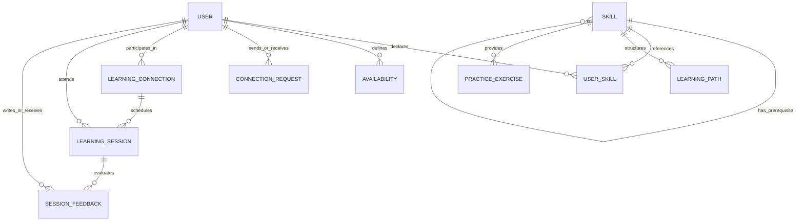

# SkillMesh — AI-Assisted Peer Learning Network

[](https://nodejs.org/)
[](https://react.dev/)
[](https://expressjs.com/)
[](https://www.mongodb.com/)
[](#academic-attribution)
[](#testing--verification-suite)

> **MIT Arts, Commerce & Science College (ACSC), Alandi (D), Pune**  
> **Bachelor of Computer Applications (TYBCA) — Semester V Field Project**  
> *Production-Minded, Full-Stack Academic Web Application with Explainable AI & Graph Analytics*

---

## 📖 Table of Contents

1. [Executive Summary](#-executive-summary)
2. [Problem Statement & Academic Rationale](#-problem-statement--academic-rationale)
3. [Core Technical Innovations](#-core-technical-innovations)
4. [System Architecture & Data Flow](#-system-architecture--data-flow)
5. [Monorepo Project Structure](#-monorepo-project-structure)
6. [Technology Stack](#-technology-stack)
7. [Comprehensive REST API Reference](#-comprehensive-rest-api-reference)
8. [Database Schema & Data Models](#-database-schema--data-models)
9. [Installation & Local Setup](#-installation--local-setup)
10. [Pre-Seeded Demo Personas & Credentials](#-pre-seeded-demo-personas--credentials)
11. [13-Step Automated Evaluation Scenario](#-13-step-automated-evaluation-scenario)
12. [Testing & Verification Suite](#-testing--verification-suite)
13. [Frontend Experience & Design System](#-frontend-experience--design-system)
14. [Security, Privacy & RBAC Architecture](#-security-privacy--rbac-architecture)
15. [Viva Defense / Academic Q&A Guide](#-viva-defense--academic-qa-guide)
16. [Academic Attribution & License](#-academic-attribution--license)

---

## 🎯 Executive Summary

**SkillMesh** (also branded as **SkillSwap**) is an intelligent, peer-to-peer academic skill-sharing platform engineered specifically for collegiate environments. Unlike unstructured chat channels, informal study groups, or commercial tutor marketplaces, SkillMesh establishes a **structured, reciprocal, and verifiable learning economy** on campus.

Students register competencies they can teach and topics they wish to master. The platform leverages a **Deterministic Reciprocal Matching Engine** and a **Directed Acyclic Graph (DAG) Skill Taxonomy** to identify optimal 1-on-1 peer partnerships as well as 3-way circular learning circles ($A \to B \to C \to A$), enforces collision-free scheduling, guides students through AI-curated milestone roadmaps, and provides academic faculty coordinators with aggregate analytics to detect campus-wide skill deficits.

---

## 💡 Problem Statement & Academic Rationale

In contemporary higher education institutions:
1. **The Discovery Paradox:** Students in the same department frequently have complementary skills (e.g., Student A excels at Flutter mobile development but struggles with relational SQL, while Student B understands SQL normalization but wants to learn Flutter), yet have no systematic mechanism to discover one another.
2. **Prerequisite Roadblocks:** Learners frequently attempt advanced topics without foundational competencies, leading to high frustration and abandonment.
3. **Scheduling Collision & Ghosting:** Informal study commitments fail due to time slot conflicts, lack of reminders, and absence of accountability.
4. **Institutional Invisibility:** College departments and faculty coordinators lack real-time visibility into which industry-relevant skills students are actively struggling with, making curriculum adjustments reactive rather than proactive.

SkillMesh addresses all four challenges through deterministic algorithms, graph theory, and privacy-preserving institutional reporting.

---

## ⚡ Core Technical Innovations

### 1. Deterministic Reciprocal Matching Engine
Located in [`server/src/services/matchingService.js`](file:///d:/feild%20project/server/src/services/matchingService.js):
- **Hard Eligibility Filtering:** Enforces strict preconditions (account active, no mutual block, mentor proficiency strictly exceeds learner's current baseline: $P_{\text{mentor}} > P_{\text{learner}}$, mentor weekly capacity not exhausted).
- **Multi-Factor Weighted Scoring Formula (100-Point Model):**
  $$\text{Score} = (S \times 0.40) + (G \times 0.20) + (A \times 0.15) + (F \times 0.10) + (R \times 0.10) + (C \times 0.05)$$
  - **Skill Compatibility ($S$, 40%):** Proficiency differential between mentor level and learner target.
  - **Goal Priority ($G$, 20%):** High Priority = 20 pts, Medium = 16 pts, Low = 13 pts.
  - **Schedule Overlap ($A$, 15%):** Exact interval matching across recurring weekly availability windows.
  - **Format Alignment ($F$, 10%):** Compatibility across Online, In-Person, or Hybrid preferences.
  - **Reciprocal Swap Value ($R$, 10%):** High-priority bonus if candidate mentor simultaneously desires a skill taught by the learner.
  - **Capacity Factor ($C$, 5%):** Mentor's remaining weekly teaching bandwidth.
- **Explainable Match Generation:** Returns human-readable, data-backed rationales for every match (e.g., *"Direct Reciprocal Match: You can teach Flutter, which Bhavya wants to learn!"*).
- **Multi-Person Cycle Detection:** Runs bounded Depth-First Search (DFS, depth $\le 3$) to discover 3-person closed exchange loops ($A \xrightarrow{\text{teaches}} B \xrightarrow{\text{teaches}} C \xrightarrow{\text{teaches}} A$).

### 2. Directed Acyclic Graph (DAG) Skill Taxonomy
Located in [`server/src/services/skillGraphService.js`](file:///d:/feild%20project/server/src/services/skillGraphService.js):
- **Graph Representation:** Skills are vertices $V$, prerequisite dependencies are directed edges $E$ in graph $G = (V, E)$.
- **Cycle Prevention:** Before creating any prerequisite link $u \to v$, the engine traverses the ancestral tree using BFS/DFS. If $v$ is already an ancestor of $u$, the insertion is rejected to preserve the DAG invariant.
- **Missing Prerequisite Detection:** When a student enrolls in an ambitious learning goal (e.g., *Machine Learning Foundations*), the engine computes the full prerequisite closure and flags any missing foundational skills (e.g., *Python Programming*, *Linear Algebra*).

### 3. Conflict-Free Interval Scheduling
Located in [`server/src/controllers/sessionController.js`](file:///d:/feild%20project/server/src/controllers/sessionController.js):
- Validates proposed sessions against existing commitments for both participants:
  $$\text{Collision Condition: } (T_{\text{start}} < \text{Existing.endTime}) \land (T_{\text{end}} > \text{Existing.startTime})$$
- Automatically rejects overlapping proposals with an `HTTP 409 Conflict` status.
- Manages session lifecycle: `proposed` $\to$ `scheduled` $\to$ `completed` $\to$ `reviewed`.
- Requires practical deliverable submission (e.g., GitHub repository URL, live deployment) before marking a session complete.

### 4. Personalized AI Workspace with Deterministic Fallbacks
Located in [`server/src/services/aiService.js`](file:///d:/feild%20project/server/src/services/aiService.js):
- Generates structured learning milestones, step-by-step concepts, and practical coding exercises.
- **Zero-Config Resiliency:** When external AI APIs are not configured (`AI_PROVIDER=fallback`), the platform automatically activates a built-in curriculum engine with pre-authored, high-quality academic templates.

### 5. Institutional Privacy-Safe Analytics
Located in [`server/src/services/analyticsService.js`](file:///d:/feild%20project/server/src/services/analyticsService.js):
- **Support Deficit Detection:** Calculates skill deficit ratios:
  $$\text{Deficit} = \text{Learner Demand Count} - \text{Mentor Teaching Capacity}$$
- Identifies critical skills requiring faculty workshops or guest lectures.
- **Privacy Defense:** Strips all student PII (emails, names, phone numbers) from coordinator views, delivering aggregated institutional metrics.

---

## 🏛️ System Architecture & Data Flow

```
+---------------------------------------------------------------------------------------+
|                                    CLIENT TIER                                        |
|  React 18 SPA (Vite) | Vanilla CSS Chalkboard Design System | Lucide React Icons      |
|  - 20 Dedicated Application Views                                                     |
|  - Dual Mode Viewport: Fluid Desktop View + Interactive iPhone 16 Pro Simulator Frame |
+-------------------------------------------+-------------------------------------------+
                                            |
              +-----------------------------+-----------------------------+
              | (Auth & Profile Sync)                                     | (REST API Calls with
              v                                                           v  HTTP-Only Cookies)
+-------------------------------+                       +-------------------------------+
|     FIREBASE CLOUD TIER       |                       |       EXPRESS.JS ROUTER       |
| - Firebase Auth (OAuth Popup) |                       | - Prefix: /api/v1             |
| - Cloud Firestore (Doc Sync)  |                       | - Rate Limiter (500 req/15m)  |
+-------------------------------+                       | - Helmet Security Headers     |
                                                        | - Cookie Parser & Zod Guards  |
                                                        +---------------+---------------+
                                                                        |
                                    +-----------------------------------+-----------------------------------+
                                    |                                   |                                   |
                                    v                                   v                                   v
                      +---------------------------+       +---------------------------+       +---------------------------+
                      |     MATCHING ENGINE       |       |     SKILL GRAPH SERVICE   |       |       AI & ANALYTICS      |
                      | - 6-Step Pipeline         |       | - DAG Cycle Detection     |       | - Milestone Roadmaps      |
                      | - Bounded DFS (3-Cycles)  |       | - Missing Prereq Traversal|       | - Deficit Aggregation     |
                      | - Stored-Data Explanations|       | - Topological Sorting     |       | - Deterministic Fallbacks |
                      +-------------+-------------+       +-------------+-------------+       +-------------+-------------+
                                    |                                   |                                   |
                                    +-----------------------------------+-----------------------------------+
                                                                        |
                                                                        v
                                                        +-------------------------------+
                                                        |      DATABASE STORAGE TIER    |
                                                        |  Mongoose 8.9 ODM             |
                                                        |  - MongoDB Atlas (Cloud) OR   |
                                                        |  - MongoMemoryServer (Local)  |
                                                        +-------------------------------+
```

---

## 📂 Monorepo Project Structure

```
d:/feild project/
├── .env.example                       # Reference environment variables
├── .gitignore                         # Git exclusion rules (node_modules, .env, dist)
├── docker-compose.yml                 # Local containerized MongoDB 7.0 deployment
├── package.json                       # Workspace orchestrator (scripts: dev, seed, demo, test)
├── README.md                          # Comprehensive project documentation
│
├── docs/
│   └── architecture.md                # Formal Software Architecture Document (SAD)
│
├── client/                            # React 18 + Vite Frontend Application
│   ├── index.html                     # HTML5 single-page application entry point
│   ├── package.json                   # Client dependencies (React, Lucide, Firebase)
│   ├── vite.config.js                 # Vite bundler configuration & local proxy (/api)
│   └── src/
│       ├── main.jsx                   # React root hydration
│       ├── App.jsx                    # Application routing (20 routes) & frame simulator
│       ├── index.css                  # Complete Vanilla CSS Design System (no Tailwind)
│       ├── app/
│       │   ├── AuthContext.jsx        # JWT cookie & Firebase user state management
│       │   ├── SkillSwapContext.jsx   # Global application state & simulated directory
│       │   └── ToastContext.jsx       # Floating post-it alert notifications
│       ├── components/
│       │   ├── EmptyState.jsx         # Uniform empty status illustration
│       │   ├── LoadingSpinner.jsx     # Consistent loading indicator
│       │   ├── Modal.jsx              # Reusable modal container
│       │   ├── SkillGraphViewer.jsx   # Dynamic SVG visualization of prerequisite DAG
│       │   ├── common/
│       │   │   └── ScreenNavigator.jsx# Floating 20-screen directory & mode toggle
│       │   ├── layout/
│       │   │   ├── Navbar.jsx         # Top desktop navigation bar with active badges
│       │   │   └── MobileBottomNav.jsx# Bottom navigation bar for mobile viewports
│       │   └── modals/
│       │       ├── CircleCelebrationModal.jsx # 3-way circle establishment modal
│       │       ├── RatingReviewModal.jsx      # Session rubric review dialog
│       │       ├── ScheduleSessionModal.jsx   # Conflict-free session booking dialog
│       │       └── SwapRequestModal.jsx       # 1-to-1 proposal dialog
│       ├── features/                  # Feature-driven module architecture
│       │   ├── admin/                 # Coordinator & Admin management panels
│       │   ├── analytics/             # Institutional capacity & deficit dashboards
│       │   ├── auth/                  # Login, Signup, and 1-click evaluation shortcuts
│       │   ├── chat/                  # Direct 1-on-1 peer messaging view
│       │   ├── circles/               # 3-Way circular learning circle creation & chat
│       │   ├── connections/           # Active partnerships & relationship status
│       │   ├── dashboard/             # Student home dashboard with progress metrics
│       │   ├── landing/               # Hero landing presentation
│       │   ├── learning/              # AI-curated workspace, roadmaps & coding challenges
│       │   ├── matching/              # Reciprocal match directory & inbound inbox
│       │   ├── notifications/         # Notification feeds
│       │   ├── onboarding/            # Initial skill preference setup wizard
│       │   ├── profile/               # Student academic portfolio & reputation display
│       │   ├── progress/              # Personal competency growth tracking
│       │   ├── sessions/              # Upcoming/past session manager & review submission
│       │   ├── settings/              # Account settings & availability interval editor
│       │   └── skills/                # Prerequisite graph explorer & catalog
│       └── lib/
│           ├── api.js                 # Centralized HTTP client (fetch with credentials)
│           └── firebase.js            # Firebase App, Auth & Firestore integration
│
└── server/                            # Node.js + Express.js REST API Backend
    ├── package.json                   # Server dependencies (Express, Mongoose, Zod, JWT)
    ├── vitest.config.js               # Server-side test runner configuration
    ├── scripts/
    │   ├── clearDatabase.js           # Database teardown utility
    │   ├── demoRunner.js              # 13-Step Automated End-to-End Evaluation script
    │   └── seed.js                    # MIT ACSC curriculum taxonomy & demo accounts seeder
    └── src/
        ├── index.js                   # Server entry point with auto-seeding hook
        ├── app.js                     # Express app setup, middleware, and route mounting
        ├── config/
        │   ├── db.js                  # Dual-mode DB connection (Atlas or In-Memory)
        │   └── env.js                 # Centralized environment variable validation
        ├── middleware/
        │   ├── authMiddleware.js      # JWT cookie verification & role guards
        │   ├── errorMiddleware.js     # Global HTTP error handler & Zod formatter
        │   ├── rateLimiter.js         # express-rate-limit configuration
        │   └── validationMiddleware.js# Zod request validation wrapper
        ├── models/                    # Mongoose Data Schemas (13 collections)
        │   ├── AssessmentAttempt.js   # Quiz/exercise submission records
        │   ├── Availability.js        # Weekly recurring availability windows
        │   ├── ConnectionRequest.js   # Pending/accepted partnership proposals
        │   ├── ContentReport.js       # Student moderation reports
        │   ├── LearningConnection.js  # Established peer partnerships
        │   ├── LearningPath.js        # Structured learning milestone roadmaps
        │   ├── LearningSession.js     # Scheduled learning sessions & deliverables
        │   ├── Notification.js        # User event notifications
        │   ├── PracticeExercise.js    # Coding challenges with hints and solutions
        │   ├── SessionFeedback.js     # 1-5 star peer ratings and rubric reviews
        │   ├── Skill.js               # Core taxonomy nodes & prerequisite edges
        │   ├── User.js                # Student/faculty accounts & credentials
        │   └── UserSkill.js           # Student teaching offers and learning goals
        ├── routes/                    # Express REST route controllers
        │   ├── adminRoutes.js         # /api/v1/admin
        │   ├── analyticsRoutes.js     # /api/v1/analytics
        │   ├── authRoutes.js          # /api/v1/auth
        │   ├── connectionRoutes.js    # /api/v1/connections
        │   ├── learningRoutes.js      # /api/v1/learning
        │   ├── matchingRoutes.js      # /api/v1/matching
        │   ├── sessionRoutes.js       # /api/v1/sessions
        │   ├── skillRoutes.js         # /api/v1/skills
        │   └── userRoutes.js          # /api/v1/users
        ├── services/                  # Intelligent algorithmic services
        │   ├── aiService.js           # Roadmap & exercise generation with fallback
        │   ├── analyticsService.js    # Privacy-safe aggregate deficit calculation
        │   ├── matchingService.js     # Reciprocal scoring & 3-way cycle detection
        │   └── skillGraphService.js   # Graph traversal & cycle prevention
        ├── utils/
        │   ├── jwt.js                 # Token signing, cookie attachment & verification
        │   └── logger.js              # Standardized console logging helper
        └── validators/                # Strict Zod validation schemas
            ├── authValidators.js
            ├── connectionValidators.js
            ├── learningValidators.js
            ├── sessionValidators.js
            └── skillValidators.js
```

---

## 🛠️ Technology Stack

| Domain | Technology | Version | Engineering Justification |
| :--- | :--- | :--- | :--- |
| **Frontend Framework** | React | `18.3.1` | Declarative UI, component reusability, optimal virtual DOM diffing. |
| **Build Tool** | Vite | `5.4.14` | Sub-second Hot Module Replacement (HMR) and optimized rollup production bundles. |
| **Styling** | Plain Vanilla CSS | Native CSS3 | **Strictly No Tailwind CSS.** Custom design tokens, high maintainability, and clean CSS variables. |
| **Routing** | React Router DOM | `6.29.0` | Client-side routing across all 20 views with protected route guards. |
| **Icons** | Lucide React | `0.475.0` | Lightweight, scalable vector iconography for intuitive academic UI. |
| **Backend Runtime** | Node.js | `v18.0+ / v24` | Modern ES Modules (`import/export`), asynchronous event-driven I/O. |
| **Web Server** | Express.js | `4.21.2` | Minimalist, unopinionated REST API framework with middleware pipelining. |
| **Database** | MongoDB & Mongoose | `8.9.5` | Document-oriented flexibility for nested graph edges and scheduling intervals. |
| **In-Memory Fallback**| mongodb-memory-server| `10.1.3` | **Zero-setup execution:** Spins up temporary MongoDB automatically if no local daemon is running. |
| **Authentication** | JWT & bcryptjs | `9.0.2 / 2.4.3` | Encrypted token authentication transmitted exclusively via HTTP-only cookies. |
| **Request Validation**| Zod | `3.24.1` | Compile-time and runtime type safety; guarantees valid input before business logic. |
| **Security Headers** | Helmet | `8.0.0` | Prevents clickjacking, MIME-sniffing, and cross-site scripting vulnerabilities. |
| **Rate Limiting** | express-rate-limit| `7.5.0` | Protects API against Denial-of-Service and brute-force credential stuffing. |
| **Unit/Integration** | Vitest & Supertest | `3.0.5 / 7.0.0` | High-speed test execution with jsdom DOM emulation. |

---

## 📡 Comprehensive REST API Reference

Base URL: `http://localhost:5000/api/v1`

### 1. Authentication Endpoints (`/auth`)
| Method | Endpoint | Access | Description | Request Body / Parameters |
| :--- | :--- | :--- | :--- | :--- |
| `POST` | `/auth/register` | Public | Register student account | `{ name, email, password, college, department }` |
| `POST` | `/auth/login` | Public | Authenticate user & set JWT cookie | `{ email, password }` |
| `POST` | `/auth/logout` | Authenticated | Invalidate session & clear cookie | None |
| `GET` | `/auth/me` | Authenticated | Retrieve authenticated user profile | None |

### 2. User & Availability Endpoints (`/users`)
| Method | Endpoint | Access | Description | Request Body / Parameters |
| :--- | :--- | :--- | :--- | :--- |
| `GET` | `/users/profile` | Authenticated | Get full profile with skills & stats | None |
| `PUT` | `/users/profile` | Authenticated | Update user bio, department, avatar | `{ bio, college, department, avatar }` |
| `GET` | `/users/availability` | Authenticated | Get weekly recurring availability slots | None |
| `PUT` | `/users/availability` | Authenticated | Set weekly available time windows | `{ slots: [{ dayOfWeek, startTime, endTime }] }` |

### 3. Skill & Graph Endpoints (`/skills`)
| Method | Endpoint | Access | Description | Request Body / Parameters |
| :--- | :--- | :--- | :--- | :--- |
| `GET` | `/skills` | Public | Retrieve entire skill taxonomy | Query: `?category=&search=` |
| `GET` | `/skills/graph` | Public | Get full SVG/JSON Directed Graph | Vertices (skills) and directed edges (prereqs) |
| `POST` | `/skills` | Admin/Coord | Create new approved skill | `{ name, category, description, prerequisites }` |
| `GET` | `/skills/my-skills` | Authenticated | Get current user's teaching/learning skills | None |
| `POST` | `/skills/my-skills` | Authenticated | Add skill offer or learning goal | `{ skillId, role: 'teach'\|'learn', proficiency }` |
| `DELETE` | `/skills/my-skills/:id`| Authenticated | Remove skill from personal profile | None |

### 4. Reciprocal Matching Endpoints (`/matching`)
| Method | Endpoint | Access | Description | Request Body / Parameters |
| :--- | :--- | :--- | :--- | :--- |
| `GET` | `/matching/recommendations` | Authenticated | Compute ranked reciprocal matches | Returns scored partners with structured explanations |
| `GET` | `/matching/circles` | Authenticated | Discover 3-way circular learning groups | Returns triangles ($A \to B \to C \to A$) |

### 5. Connection Requests Endpoints (`/connections`)
| Method | Endpoint | Access | Description | Request Body / Parameters |
| :--- | :--- | :--- | :--- | :--- |
| `POST` | `/connections/request` | Authenticated | Send swap or mentorship request | `{ recipientId, skillOfferedId, skillRequestedId, note }` |
| `GET` | `/connections/inbox` | Authenticated | Get incoming and outgoing requests | Filter by status: `pending`, `accepted`, `declined` |
| `PUT` | `/connections/:id/respond`| Authenticated | Accept or decline connection request | `{ action: 'accept' \| 'decline' }` |
| `GET` | `/connections/active` | Authenticated | List all active established partnerships | Returns partners, connected skills, and session history |

### 6. Session Scheduling & Reviews (`/sessions`)
| Method | Endpoint | Access | Description | Request Body / Parameters |
| :--- | :--- | :--- | :--- | :--- |
| `POST` | `/sessions` | Authenticated | Schedule session (validates conflicts) | `{ connectionId, skillId, startTime, endTime, format, meetingUrl }` |
| `GET` | `/sessions` | Authenticated | List user sessions | Query: `?status=scheduled\|completed` |
| `PUT` | `/sessions/:id/status` | Authenticated | Update status (complete, cancel) | `{ status: 'completed', deliverableUrl: 'https://...' }` |
| `POST` | `/sessions/:id/review` | Authenticated | Submit peer feedback & 1-5 rating | `{ rating: 5, comment: '...', criteriaScores: {...} }` |

### 7. Learning Workspace & AI Endpoints (`/learning`)
| Method | Endpoint | Access | Description | Request Body / Parameters |
| :--- | :--- | :--- | :--- | :--- |
| `GET` | `/learning/path/:skillId`| Authenticated | Get or generate milestone roadmap | Returns ordered milestones and concept checklists |
| `GET` | `/learning/exercises/:skillId`| Authenticated | Retrieve practical coding challenges | Returns exercises with instructions & hidden rubrics |
| `POST` | `/learning/exercises/:id/submit`| Authenticated | Record practice attempt/solution | `{ codeSubmission, notes }` |

### 8. Institutional Analytics & Administration (`/analytics` & `/admin`)
| Method | Endpoint | Access | Description | Request Body / Parameters |
| :--- | :--- | :--- | :--- | :--- |
| `GET` | `/analytics/overview` | Coordinator/Admin | Campus-wide demand vs capacity | Privacy-safe aggregate counts |
| `GET` | `/analytics/deficits` | Coordinator/Admin | Identify unsupported high-demand skills | Deficit delta: $\text{Learners} - \text{Mentors}$ |
| `GET` | `/admin/users` | Admin | Manage student account standing | Query: `?status=active\|suspended` |
| `PUT` | `/admin/users/:id/status`| Admin | Moderate student account | `{ status: 'active' \| 'suspended' }` |

---

## 🗄️ Database Schema & Data Models

SkillMesh utilizes 13 structured Mongoose models:



### Key Schema Descriptions
1. **`User`:** Identity records containing `name`, unique `email`, hashed `password`, academic metadata (`college`, `department`, `year`), `role` (`student`, `coordinator`, `admin`), `accountStatus`, and aggregate `reputationScore`.
2. **`Skill`:** Nodes in the skill graph with `name`, `normalizedName`, `category`, `description`, `approved` flag, and an array of `prerequisites` referencing other `Skill` ObjectIDs.
3. **`UserSkill`:** Junction collection storing whether a user `teaches` or `learns` a given `skill`, with self-assessed `proficiency` (1: Beginner to 5: Expert), `priority`, and verified completion status.
4. **`Availability`:** Recurring weekly availability windows storing `dayOfWeek` (0-6), `startTime` ("17:00"), and `endTime` ("19:00").
5. **`LearningConnection`:** Established mutual partnership record containing both student references, reciprocal skill IDs, and connection status.
6. **`LearningSession`:** Scheduled learning appointments storing participant IDs, interval `startTime` and `endTime`, format (`online`/`in-person`), `status` (`scheduled`, `completed`, `cancelled`), and `deliverableUrl` (proof of practical work).
7. **`SessionFeedback`:** Multi-criteria 1–5 star reviews, feedback comments, and rubric scores across Clarity, Preparedness, and Helpfulness.

---

## 🚀 Installation & Local Setup

### 1. System Requirements
- **Node.js:** `v18.0.0` or higher (Fully tested on Node `v24.x`)
- **npm:** `v9.0.0` or higher
- **MongoDB:** *(Optional)* Local daemon or Atlas URI. If no MongoDB is detected, SkillMesh automatically activates an embedded in-memory database instance.

### 2. Clone & Install Dependencies
Clone the repository and install all dependencies across root, server, and client:
```bash
git clone https://github.com/amanjc81-code/skillSwap.git
cd skillSwap

# Install dependencies in root, server, and client concurrently
npm run install:all
```

### 3. Configure Environment Variables
Copy `.env.example` to `.env` in the root directory:
```bash
cp .env.example .env
```

Default `.env` configuration:
```env
PORT=5000
NODE_ENV=development
MONGODB_URI=mongodb://127.0.0.1:27017/skillmesh
JWT_SECRET=skillmesh-insecure-development-secret-key-32chars
JWT_EXPIRES_IN=7d
COOKIE_SECURE=false
CORS_ORIGIN=http://localhost:5173

# AI Provider Configuration (defaults to deterministic fallback)
AI_PROVIDER=fallback
AI_API_KEY=
AI_MODEL=
```

### 4. Seed the Database
Populate the database with the MIT ACSC curriculum, directed prerequisite graph, demo students, and historic sessions:
```bash
npm run seed
```

### 5. Launch the Full-Stack Application
Start both the Express backend and the Vite client concurrently:
```bash
npm run dev
```

- **Frontend Client:** [http://localhost:5173](http://localhost:5173)
- **Backend REST API:** [http://localhost:5000/api/v1](http://localhost:5000/api/v1)
- **Health Check:** [http://localhost:5000/api/v1/health](http://localhost:5000/api/v1/health)

---

## 👥 Pre-Seeded Demo Personas & Credentials

The seed script creates a complete collegiate ecosystem designed for demonstration:

| Persona | Name | Email | Password | Academic Competencies | Role in Evaluation |
| :--- | :--- | :--- | :--- | :--- | :--- |
| **Student A** | Aarav Sharma | `aarav.sharma@mitacsc.ac.in` | `Student@123` | **Teaches:** Flutter (Adv)<br>**Learns:** SQL | Mutual Reciprocal Match with Student B |
| **Student B** | Bhavya Patel | `bhavya.patel@mitacsc.ac.in` | `Student@123` | **Teaches:** SQL (Adv)<br>**Learns:** Flutter | Mutual Reciprocal Match with Student A |
| **Student C** | Chirag Joshi | `chirag.joshi@mitacsc.ac.in` | `Student@123` | **Teaches:** UI/UX Design<br>**Learns:** Python | 3-Way Circular Exchange ($C \to D \to E \to C$) |
| **Student D** | Divya Deshmukh| `divya.deshmukh@mitacsc.ac.in`| `Student@123` | **Teaches:** Python<br>**Learns:** React | 3-Way Circular Exchange |
| **Student E** | Eshan Kulkarni| `eshan.kulkarni@mitacsc.ac.in`| `Student@123` | **Teaches:** React<br>**Learns:** UI/UX Design | 3-Way Circular Exchange |
| **Faculty** | Prof. Anjali Mehta| `coordinator@mitacsc.ac.in`| `Coordinator@123`| Department Coordinator | Institutional Deficit Dashboard |
| **Admin** | Administrator | `admin@mitacsc.ac.in` | `Admin@123` | System Administrator | User moderation & standing controls |

> **Evaluator Convenience:** The web login screen includes **1-click quick-fill buttons** to test any persona without manual typing.

---

## 🎬 13-Step Automated Evaluation Scenario

SkillMesh contains a standalone test runner that simulates the entire lifecycle required for evaluation. Run it in your terminal:

```bash
npm run demo
```

```
[DEMO RUNNER] STEP 1: Authenticating Student A (Aarav Sharma)... SUCCESS (HTTP 200)
[DEMO RUNNER] STEP 2: Authenticating Student B (Bhavya Patel)... SUCCESS (HTTP 200)
[DEMO RUNNER] STEP 3: Fetching Skill Taxonomy & Prerequisite DAG... SUCCESS (12 Skills Loaded)
[DEMO RUNNER] STEP 4: Querying Reciprocal Matches for Student A... SUCCESS (Bhavya Patel: Score 97%)
[DEMO RUNNER] STEP 5: Verifying Stored Match Explanations... SUCCESS ("Direct Reciprocal Match: Flutter <-> SQL")
[DEMO RUNNER] STEP 6: Student A sends Swap Connection Request to Student B... SUCCESS (Request ID Created)
[DEMO RUNNER] STEP 7: Student B accepts Connection Request... SUCCESS (Active Connection Established)
[DEMO RUNNER] STEP 8: Scheduling Learning Session for Tuesday 17:00-18:00... SUCCESS (Session ID Created)
[DEMO RUNNER] STEP 9: Testing Overlapping Booking Collision Defense... SUCCESS (Rejected with HTTP 409 Conflict)
[DEMO RUNNER] STEP 10: Marking Session as Completed with Deliverable URL... SUCCESS (GitHub Repo Verified)
[DEMO RUNNER] STEP 11: Submitting 5-Star Peer Rubric Review... SUCCESS (Rating Recorded)
[DEMO RUNNER] STEP 12: Generating AI Practice Exercises for SQL... SUCCESS (Milestones & Challenges Loaded)
[DEMO RUNNER] STEP 13: Coordinator querying Institutional Deficit Analytics... SUCCESS (Deficit Delta Computed)
```

---

## 🧪 Testing & Verification Suite

The repository contains 25 automated unit and integration tests across backend controllers, graph algorithms, and frontend components.

```bash
# Run all tests across the monorepo
npm run test

# Run backend tests only
npm run test:server

# Run frontend tests only
npm run test:client
```

### Verified Test Categories
- **Authentication & Security:** Cookie persistence, invalid credential rejection, password hashing, and role escalation prevention.
- **DAG Graph Integrity:** Cycle detection in prerequisite chains ($A \to B \to A$ rejection) and ancestral prerequisite traversal.
- **Reciprocal Matching Engine:** Correct score weighting, hard eligibility filters, and 3-way cycle discovery.
- **Session Scheduling:** Mathematical interval overlap detection (`HTTP 409 Conflict`) and deliverable recording.
- **Frontend Components:** Match card rendering, 1-click login triggers, and request proposal modals.

---

## 🎨 Frontend Experience & Design System

The frontend was built from scratch without external component libraries or utility CSS frameworks.

### Design Principles:
1. **The Modern Academic Chalkboard:** Built with deep forest green hues (`#0d2d1e`, `#123e2a`), warm paper highlights (`#FEF08A`, `#FEF9C3`), and crisp card surfaces.
2. **Dual-Mode Viewport:**
   - **Fluid Desktop View:** Full-width responsive layout for desktop evaluation.
   - **iPhone 16 Pro Simulator Frame:** Includes simulated Dynamic Island, bezel frame, and mobile navigation bar for mobile UX testing.
3. **Floating Screen Navigator:** An interactive floating directory in the bottom-left corner allowing instant navigation across all 20 pages with one click.
4. **Interactive SVG Graph:** Dynamically renders the skill prerequisite hierarchy with color-coded nodes indicating mastered vs. target skills.

---

## 🔒 Security, Privacy & RBAC Architecture

1. **HTTP-Only Cookies (`skillmesh_token`):** Tokens cannot be read by JavaScript `document.cookie`, mitigating Cross-Site Scripting (XSS) credential theft.
2. **Role Escalation Protection:** The public registration endpoint hardcodes `role: 'student'`. Elevated roles (`coordinator`, `admin`) can only be assigned through protected administrator routes.
3. **Input Validation:** Every incoming query, parameter, and request payload is validated against strict Zod schemas. Invalid payloads are rejected with detailed field-level error messages before reaching controllers.
4. **Anonymized Coordinator Reporting:** Institutional analytics do not expose individual student names, emails, or personal chat messages to faculty dashboards, preserving student privacy.

---

## 🎓 Viva Defense / Academic Q&A Guide

### Q1: Why did you build a custom reciprocal matching algorithm instead of using standard recommendation libraries?
> **Answer:** Standard collaborative filtering requires massive historical user interaction datasets that do not exist in a new college semester. Our engine is **deterministic and constraint-driven**, functioning accurately from Day 1 based on declared competencies, schedule availability intervals, and prerequisite constraints, while providing full mathematical explainability for every recommendation.

### Q2: How does the system prevent cyclic dependencies in the skill prerequisite graph?
> **Answer:** Before inserting any prerequisite edge $u \to v$, the `skillGraphService` executes a traversal starting from $v$. If $u$ is already reachable from $v$, adding $u \to v$ would create a cycle. The system detects this condition and rejects the operation, ensuring the graph remains a Directed Acyclic Graph (DAG).

### Q3: How is double-booking prevented when students schedule peer sessions?
> **Answer:** In `sessionController.js`, before confirming any session, we execute an interval intersection query: `(startTime < Existing.endTime) && (endTime > Existing.startTime)` across both participants. If an overlap is detected, the database write is blocked, and an `HTTP 409 Conflict` is returned.

### Q4: How does the platform handle environments where external AI API keys are unavailable?
> **Answer:** We implemented a resilient **Deterministic Template Fallback Engine** in `aiService.js`. If `AI_PROVIDER=fallback` or the network fails, the system serves structured, pre-curated academic roadmaps and coding exercises without throwing runtime errors.

---

## 📜 Academic Attribution & License

- **Institution:** MIT Arts, Commerce & Science College (ACSC), Pune  
- **Course:** Bachelor of Computer Applications (TYBCA) — Semester V  
- **Project Type:** Field Project Evaluation  
- **Academic Year:** 2026–2027  
- **License:** Educational & Academic Use License
