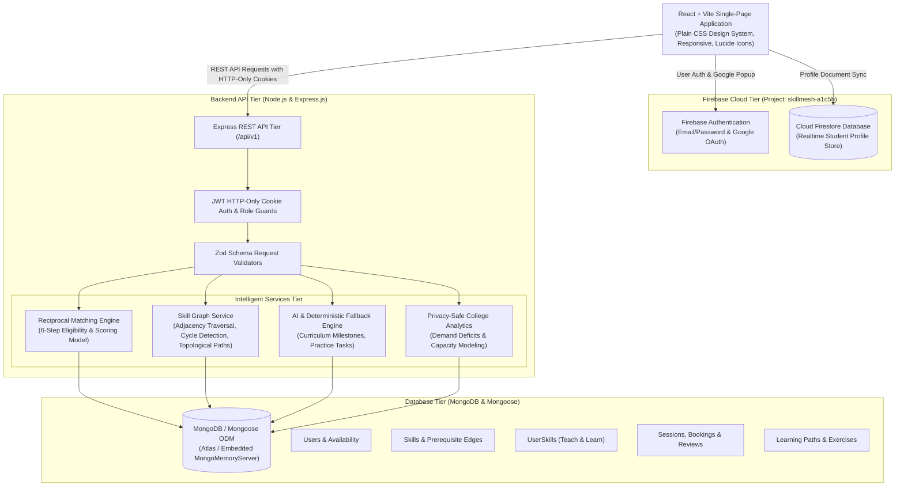

# SkillMesh System Architecture & Engineering Specification

## 1. Executive Summary

**SkillMesh** is an AI-assisted peer-to-peer learning network engineered for college students (developed for the MIT ACSC TYBCA Semester V Field Project). Unlike unstructured social forums or generic tutoring directories, SkillMesh facilitates **measurable, explainable, and reciprocal peer-learning partnerships** powered by a **Directed Skill Prerequisite Graph** and a deterministic **Reciprocal Matching Engine**.

The platform is designed to answer five central institutional questions:
1. *Who can help me learn a specific skill?*
2. *Who would benefit from the skills I can teach?*
3. *Which students are mutually compatible for a direct skill exchange?*
4. *Which prerequisite concepts or learning milestones should I complete next?*
5. *Which skills are in high demand across the college, and where is peer-learning capacity insufficient?*

---

## 2. System Architecture Diagram



---

## 3. Core Technical Innovation: The Skill Graph

### 3.1 Directed Acyclic Prerequisite Architecture
Each skill is modeled as a vertex in a directed graph $G = (V, E)$. Directed edges $(u, v) \in E$ denote that skill $u$ is a prerequisite of skill $v$.

Examples:
- $\text{JavaScript Fundamentals} \to \text{React}$
- $\text{JavaScript Fundamentals} \to \text{Node.js} \to \text{Express.js \& REST APIs}$
- $\text{Database Fundamentals} \to \text{SQL}$
- $\text{Python Programming} \to \text{Machine Learning Foundations}$

### 3.2 Cycle Prevention
Prerequisite cycles are strictly forbidden (a skill cannot transitively require itself). Cycle detection uses Breadth-First Search (BFS) / Depth-First Search (DFS) prior to persisting any edge:
```javascript
export const hasPrerequisiteCycle = async (targetSkillId, proposedPrereqId) => {
  if (targetSkillId.toString() === proposedPrereqId.toString()) return true;
  const visited = new Set();
  const queue = [proposedPrereqId.toString()];
  while (queue.length > 0) {
    const currentId = queue.shift();
    if (currentId === targetSkillId.toString()) return true;
    if (!visited.has(currentId)) {
      visited.add(currentId);
      const skill = await Skill.findById(currentId).select('prerequisites');
      if (skill?.prerequisites) {
        for (const p of skill.prerequisites) queue.push(p.toString());
      }
    }
  }
  return false;
};
```

### 3.3 Missing Prerequisite Detection
When a student selects a skill to learn, the graph traverses all ancestral prerequisite nodes and compares them against the student's claimed competencies. Any unmet prerequisites are flagged to the student before scheduling sessions.

---

## 4. Reciprocal Matching Engine Specification

The Matching Engine operates in a deterministic 6-step pipeline:

```
[Candidate Retrieval] ➔ [Eligibility Filtering] ➔ [Weighted Scoring] ➔ [Structured Explanations] ➔ [Cycle Detection] ➔ [Ranking]
```

### 4.1 Step 1: Candidate Retrieval
Identifies all students offering a skill matching the current user's learning goals.

### 4.2 Step 2: Hard Eligibility Constraints
A candidate mentor is eligible only if:
1. **Proficiency Compatibility:** Mentor self-assessed proficiency exceeds the learner's current proficiency ($P_{\text{mentor}} > P_{\text{learner}}$ or $P_{\text{mentor}} \ge P_{\text{target}}$).
2. **Blocked Users:** Neither student has blocked the other.
3. **Account Status:** Both accounts are in `active` standing.
4. **Self-Exclusion:** A student cannot match with themselves.
5. **Teaching Capacity:** The mentor has not exceeded their declared weekly teaching hours.

### 4.3 Step 3: Transparent Scoring Formula
Candidates are ranked using a configurable weighted scoring model normalized to 100 points:

| Component | Weight | Criteria & Normalization |
| :--- | :---: | :--- |
| **Skill Compatibility** | **40%** | Proficiency differential between mentor and learner |
| **Goal & Priority Compatibility** | **20%** | Priority level of the learner's goal (High: 20 pts, Med: 16 pts, Low: 13 pts) |
| **Schedule Overlap** | **15%** | Number and duration of overlapping weekly time slots |
| **Learning Format Compatibility** | **10%** | Alignment between online, in-person, hybrid, or flexible preferences |
| **Reciprocal Exchange Value** | **10%** | Bonus awarded when the mentor also wants to learn a skill the user can teach |
| **Capacity & Feasibility** | **5%** | Proportion of weekly teaching hours remaining |

### 4.4 Step 4: Stored Data Explanations
Every recommendation returns an `explanations` array derived strictly from stored database facts:
- *"This student can teach SQL (advanced level), which matches your learning goal."*
- *"Direct Reciprocal Match: You can teach Flutter, which this student wants to learn!"*
- *"Preferred learning format aligns (ONLINE)."*
- *"Availability overlaps on Tuesday (17:00 - 19:00)."*

### 4.5 Step 5: Multi-Person Exchange Cycle Detection
Beyond direct 2-person reciprocal swaps, the engine constructs a directed graph of all teaching offers and learning requests, running bounded DFS (depth $\le 3$) to discover 3-way circular exchanges:
$$\text{Student A} \xrightarrow{\text{teaches Flutter}} \text{Student B} \xrightarrow{\text{teaches Python}} \text{Student C} \xrightarrow{\text{teaches React}} \text{Student A}$$

---

## 5. Booking Conflict Rejection Architecture

To prevent academic scheduling collisions, all session proposals validate time-interval intersections:
```javascript
const conflict = await LearningSession.findOne({
  status: { $in: ['scheduled', 'rescheduled'] },
  $or: [
    { 'participants.user': req.user._id },
    { 'participants.user': participantId }
  ],
  $and: [
    { startTime: { $lt: new Date(endTime) } },
    { endTime: { $gt: new Date(startTime) } }
  ]
});

if (conflict) {
  return res.status(409).json({
    success: false,
    message: 'Booking conflict detected. One of the students already has an active session during this time slot.'
  });
}
```

---

## 6. AI Features & Deterministic Fallback

1. **Personalized Learning Paths:** Formulates ordered milestones, concepts, and suggested tasks.
2. **Practice Exercises:** Generates testable code challenges with instructions, rubrics, and hidden reference solutions.
3. **Zero-Configuration Fallback:** If `AI_API_KEY` is absent or provider encounters an error, the platform activates the built-in deterministic curriculum engine with curated templates. Fallback content is transparently labeled in the UI.

---

## 7. Institutional Privacy & College Analytics

- **Role-Based Access Control:** Coordinators and Administrators are restricted via `requireRole('coordinator', 'admin')`.
- **Privacy Preservation:** College overview dashboards aggregate metrics by department and skill. Student names and contact details are excluded from coordinator analytics.
- **Support Deficit Detection:** Flags skills where $\text{Learners} > \text{Mentors}$ so college faculty can organize targeted workshops.
