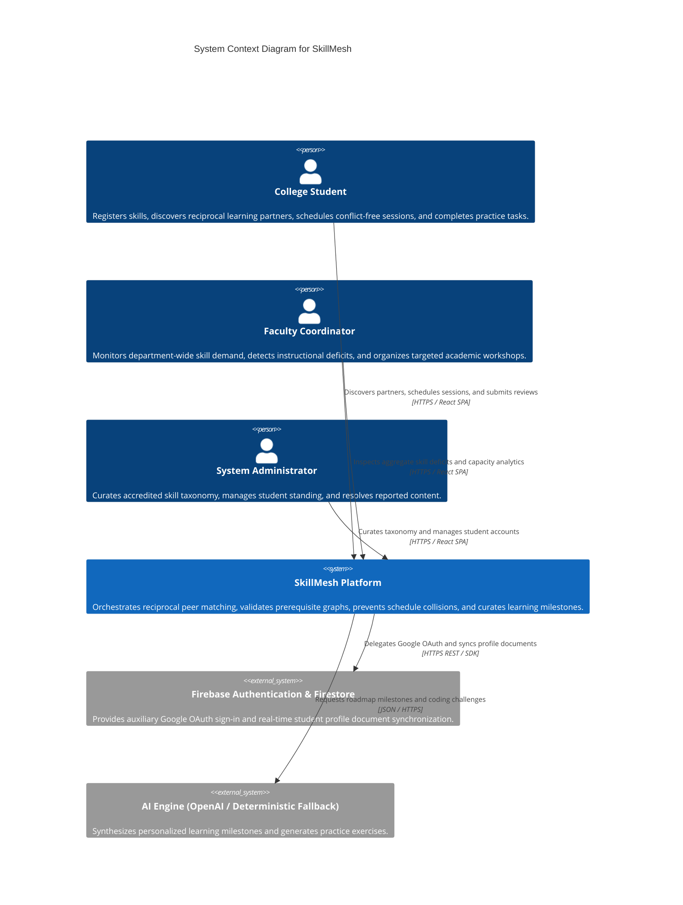
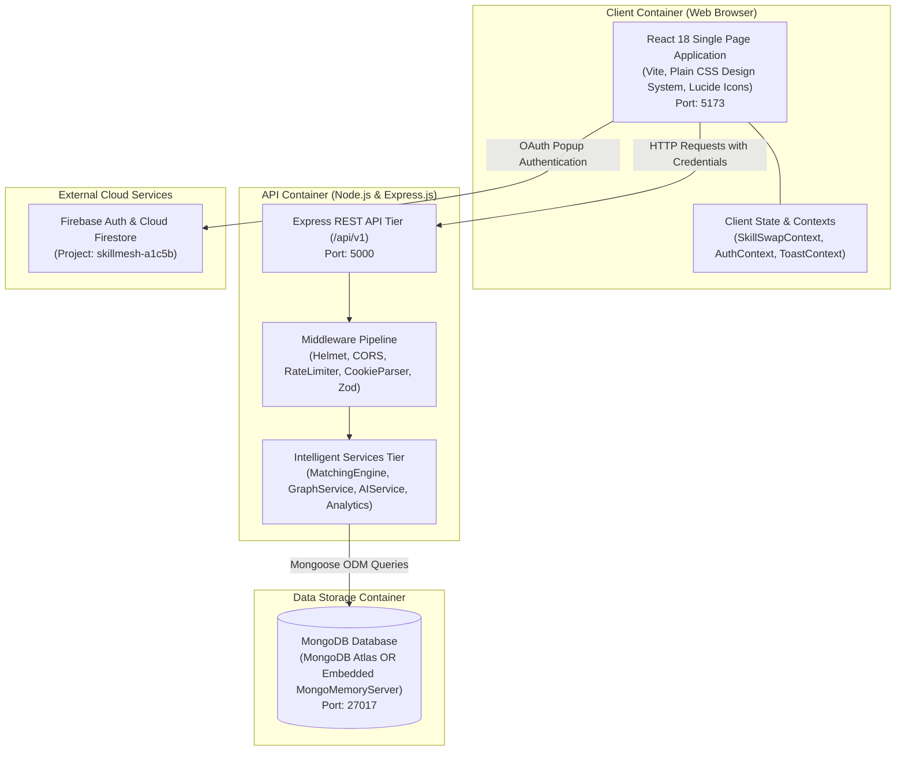
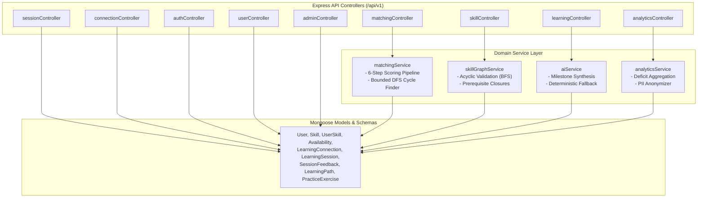
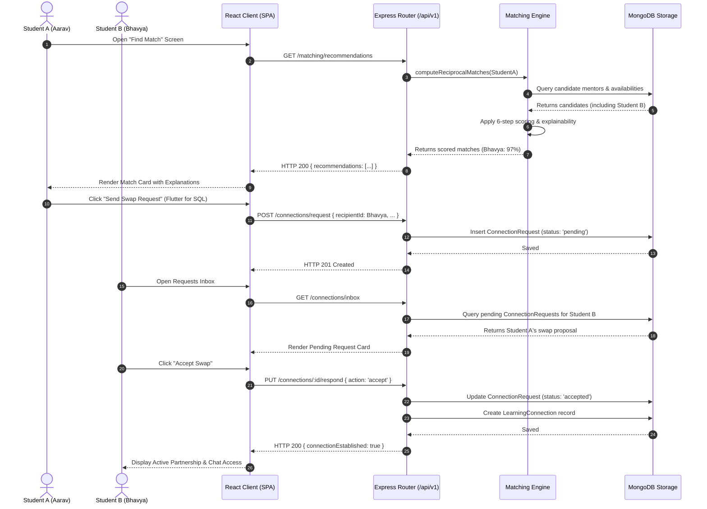
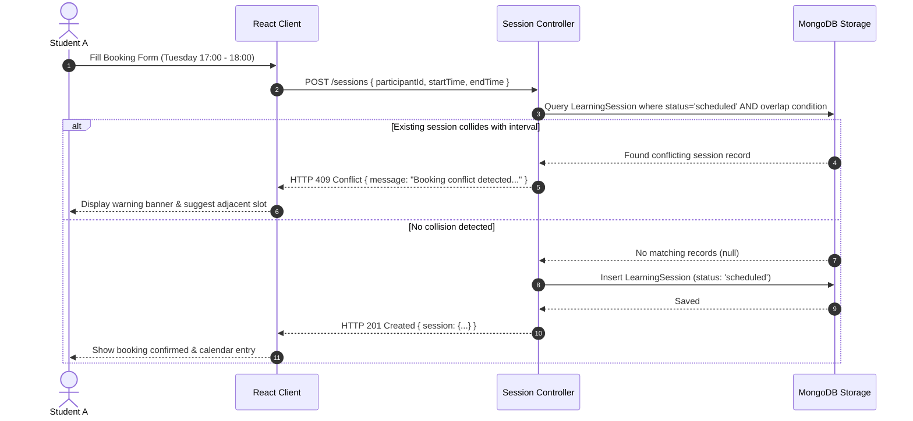
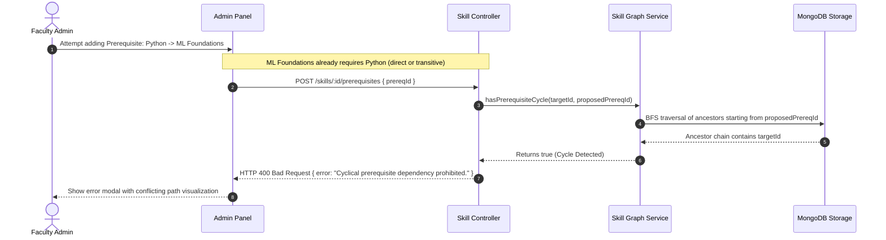
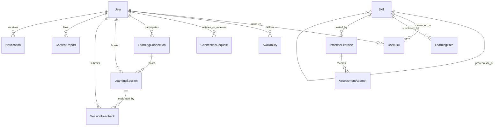

# SkillMesh System Architecture & Engineering Specification

> **Document Status:** Complete / Production-Grade  
> **Target Audience:** Academic Evaluators, Software Architects, Engineering Peers  
> **Institutional Context:** MIT ACSC TYBCA Semester V Field Project  
> **System Name:** SkillMesh (AI-Assisted Peer Learning Network)

---

## 📑 Table of Contents

1. [Architectural Drivers & Quality Attributes](#1-architectural-drivers--quality-attributes)
2. [C4 Architectural Representations](#2-c4-architectural-representations)
   - [2.1 Level 1: System Context Diagram](#21-level-1-system-context-diagram)
   - [2.2 Level 2: Container Diagram](#22-level-2-container-diagram)
   - [2.3 Level 3: Backend Component Diagram](#23-level-3-backend-component-diagram)
3. [Algorithmic Foundations & Mathematical Formulations](#3-algorithmic-foundations--mathematical-formulations)
   - [3.1 Directed Acyclic Skill Prerequisite Graph (DAG)](#31-directed-acyclic-skill-prerequisite-graph-dag)
   - [3.2 6-Stage Deterministic Reciprocal Matching Engine](#32-6-stage-deterministic-reciprocal-matching-engine)
   - [3.3 Multi-Person Circular Learning Loops (Bounded DFS)](#33-multi-person-circular-learning-loops-bounded-dfs)
   - [3.4 Conflict-Free Temporal Scheduling Engine](#34-conflict-free-temporal-scheduling-engine)
   - [3.5 Institutional Deficit Delta Metric](#35-institutional-deficit-delta-metric)
4. [Mermaid Dynamic Sequence Workflows](#4-mermaid-dynamic-sequence-workflows)
   - [4.1 Reciprocal Discovery & Connection Establishment](#41-reciprocal-discovery--connection-establishment)
   - [4.2 Conflict-Free Session Scheduling & Overlap Rejection](#42-conflict-free-session-scheduling--overlap-rejection)
   - [4.3 Skill Graph Prerequisite Cycle Rejection](#43-skill-graph-prerequisite-cycle-rejection)
5. [Database Data Dictionary & Entity-Relationship Model](#5-database-data-dictionary--entity-relationship-model)
6. [Frontend State Management & Viewport Architecture](#6-frontend-state-management--viewport-architecture)
7. [Security Architecture & Threat Modeling](#7-security-architecture--threat-modeling)
8. [Reliability, Graceful Degradation & In-Memory Fallbacks](#8-reliability-graceful-degradation--in-memory-fallbacks)

---

## 1. Architectural Drivers & Quality Attributes

SkillMesh's architectural design satisfies specific non-functional requirements (NFRs) dictated by collegiate deployment environments:

| Quality Attribute | Requirement Specification | Architectural Solution |
| :--- | :--- | :--- |
| **Explainability** | Matching recommendations must never be opaque "black boxes"; students must understand *why* a peer was recommended. | Deterministic scoring with rule-based, stored data-derived explanation generators (`matchingService.js`). |
| **Integrity** | Knowledge dependencies must remain strictly acyclic (a skill cannot transitively require itself). | BFS/DFS cycle detection traversal prior to persisting prerequisite edges in MongoDB. |
| **Concurrency & Collision**| Students must never be double-booked across concurrent sessions. | Interval intersection validation (`startTime < existing.endTime && endTime > existing.startTime`) returning `409 Conflict`. |
| **Zero-Setup Portability**| Evaluators must be able to run the full application locally without pre-installing a dedicated MongoDB daemon. | Dual-mode database connection with embedded `mongodb-memory-server` automatic fallback. |
| **Resilience** | Lack of external AI provider credentials must not crash the application. | Deterministic AI template fallback engine serving pre-curated MIT ACSC curriculum roadmaps and exercises. |
| **Security & Privacy** | Prevent Cross-Site Scripting (XSS) credential theft and safeguard student privacy in coordinator reports. | JWT transmitted exclusively via `httpOnly` cookies; PII scrubbing in coordinator analytics pipelines. |

---

## 2. C4 Architectural Representations

### 2.1 Level 1: System Context Diagram



### 2.2 Level 2: Container Diagram



### 2.3 Level 3: Backend Component Diagram



---

## 3. Algorithmic Foundations & Mathematical Formulations

### 3.1 Directed Acyclic Skill Prerequisite Graph (DAG)

SkillMesh formalizes its academic curriculum as a finite directed graph:
$$G = (V, E)$$
Where:
- $V = \{s_1, s_2, \dots, s_n\}$ represents the set of all accredited academic skills.
- $E = \{(u, v) \in V \times V\}$ represents prerequisite directed edges asserting that skill $u$ must be acquired prior to skill $v$.

#### Topological Invariant & Cycle Prevention
The graph must strictly satisfy the acyclic condition:
$$\forall u \in V, \quad \neg(u \rightsquigarrow u)$$
*(No path can lead from vertex $u$ back to vertex $u$)*.

Before adding a proposed prerequisite edge $u \to v$ (stating $u$ is prerequisite to $v$), the system executes Breadth-First Search (BFS) starting from $u$. If vertex $v$ is already reachable from $u$, inserting $u \to v$ would induce a cycle.

```javascript
// Graph cycle detection in skillGraphService.js
export const hasPrerequisiteCycle = async (targetSkillId, proposedPrereqId) => {
  if (targetSkillId.toString() === proposedPrereqId.toString()) return true;

  const visited = new Set();
  const queue = [proposedPrereqId.toString()];

  while (queue.length > 0) {
    const currentId = queue.shift();
    if (currentId === targetSkillId.toString()) return true;

    if (!visited.has(currentId)) {
      visited.add(currentId);
      const skill = await Skill.findById(currentId).select('prerequisites');
      if (skill?.prerequisites) {
        for (const p of skill.prerequisites) {
          queue.push(p.toString());
        }
      }
    }
  }
  return false;
};
```

#### Missing Prerequisite Closure
For a student aiming to learn target skill $T \in V$, the system computes the complete ancestral prerequisite closure:
$$\text{Ancestors}(T) = \{u \in V \mid u \rightsquigarrow T\}$$
Let $\text{Known}(S) \subseteq V$ be the set of skills student $S$ has verified competencies in. The set of unmet prerequisites is defined as:
$$\text{Missing}(S, T) = \text{Ancestors}(T) \setminus \text{Known}(S)$$
If $|\text{Missing}(S, T)| > 0$, the student receives an educational advisory before scheduling advanced sessions.

---

### 3.2 6-Stage Deterministic Reciprocal Matching Engine

The matching engine processes recommendations through a 6-stage constraint-and-scoring pipeline:

```
[1. Candidate Retrieval] ➔ [2. Eligibility Gate] ➔ [3. Weighted Scoring] ➔ [4. Explanation Synthesis] ➔ [5. Cycle Traversal] ➔ [6. Deterministic Sorting]
```

#### Stage 1: Candidate Retrieval
Queries all active users offering to teach at least one skill present in the current student's learning targets:
$$\mathcal{C} = \{M \in \text{Users} \mid \exists s \in \text{Teaches}(M) \cap \text{Learns}(L)\}$$

#### Stage 2: Hard Eligibility Constraints Gate
Candidate $M$ is immediately pruned if any of the following constraints are violated:
1. **Self-Exclusion:** $M.\text{id} \neq L.\text{id}$
2. **Mutual Standing:** $M.\text{status} = \text{'active'} \land L.\text{status} = \text{'active'}$
3. **Block Filter:** $M.\text{id} \notin L.\text{blockedUsers} \land L.\text{id} \notin M.\text{blockedUsers}$
4. **Proficiency Threshold:** Mentor proficiency level must strictly exceed learner's current baseline:
   $$P_{\text{mentor}}(s) > P_{\text{learner}}(s) \quad \lor \quad (P_{\text{learner}}(s) = 0 \land P_{\text{mentor}}(s) \ge 2)$$
5. **Capacity Check:** $M.\text{currentWeeklyTeachingHours} < M.\text{maxWeeklyTeachingHours}$

#### Stage 3: Multi-Factor Weighted Scoring Model
Eligible candidates are evaluated against six normalized criteria yielding a deterministic compatibility score $\in [0, 100]$:

$$\text{Final Score} = \sum_{i=1}^{6} (W_i \times C_i)$$

| Dimension ($i$) | Weight ($W_i$) | Component ($C_i$) Calculation Logic |
| :--- | :---: | :--- |
| **Skill Proficiency ($S$)** | **0.40** | Differential bonus: $\min(40, (P_M - P_L) \times 13.33)$ |
| **Target Goal Priority ($G$)**| **0.20** | High Priority = $20\,\text{pts}$, Medium = $16\,\text{pts}$, Low = $13\,\text{pts}$ |
| **Schedule Overlap ($A$)** | **0.15** | Overlapping hours $\ge 2\text{h} \implies 15\,\text{pts}$; $1\text{h} \implies 10\,\text{pts}$; else $0$ |
| **Format Alignment ($F$)** | **0.10** | Exact format match (e.g. both Online or both In-Person) $= 10\,\text{pts}$; Hybrid/Flexible $= 7\,\text{pts}$ |
| **Reciprocal Swap Value ($R$)**|**0.10**| **Mutual Exchange:** If $M$ wants to learn a skill $L$ teaches $\implies 10\,\text{pts}$; else $0$ |
| **Teaching Capacity ($C$)** | **0.05** | Ratio of remaining weekly hours: $\frac{\text{Capacity}_{\text{rem}}}{\text{Capacity}_{\text{max}}} \times 5\,\text{pts}$ |

#### Stage 4: Stored-Data Explainability Generation
For every scored match, the system populates a structured `explanations` array derived strictly from verified database records:
- *"Matches your High Priority goal for SQL."*
- *"Direct Reciprocal Match: Aarav can teach you Flutter, and you can teach Aarav SQL!"*
- *"Schedule compatible: Both available on Tuesday evenings (17:00 - 19:00)."*
- *"Preferred learning format aligns (Online)."*

---

### 3.3 Multi-Person Circular Learning Loops (Bounded DFS)

When direct 2-person reciprocal exchanges are unavailable, SkillMesh builds an exchange digraph $\mathcal{H} = (U, D)$ where directed edges $(u, v) \in D$ denote that user $u$ can teach a skill desired by user $v$.

The engine executes a bounded Depth-First Search with depth limit $k = 3$ to detect closed exchange triangles:

$$\text{Student A} \xrightarrow{\text{teaches Flutter}} \text{Student B} \xrightarrow{\text{teaches Python}} \text{Student C} \xrightarrow{\text{teaches React}} \text{Student A}$$

```javascript
// Bounded cycle traversal logic in matchingService.js
export const findCircularExchangeTriangles = async (userId) => {
  const triangles = [];
  const directMatches = await getEligibleRecipients(userId); // A -> B

  for (const b of directMatches) {
    const secondHop = await getEligibleRecipients(b.userId); // B -> C
    for (const c of secondHop) {
      if (c.userId.toString() === userId.toString()) continue;

      const closingHop = await getEligibleRecipients(c.userId); // C -> A?
      const completesCycle = closingHop.some(a => a.userId.toString() === userId.toString());

      if (completesCycle) {
        triangles.push({
          participantA: userId,
          participantB: b.userId,
          participantC: c.userId,
          skillsExchanged: {
            aToB: b.skillTaught,
            bToC: c.skillTaught,
            cToA: closingHop.find(a => a.userId.toString() === userId.toString()).skillTaught
          }
        });
      }
    }
  }
  return triangles;
};
```

---

### 3.4 Conflict-Free Temporal Scheduling Engine

To prevent academic scheduling collisions, proposed session intervals $[S_{\text{new}}, E_{\text{new}})$ are evaluated against all confirmed appointments for both students.

#### Interval Intersection Theorem
Two continuous time intervals $[S_1, E_1)$ and $[S_2, E_2)$ intersect if and only if:
$$S_1 < E_2 \quad \land \quad E_1 > S_2$$

```javascript
// Collision query executed in sessionController.js
const conflict = await LearningSession.findOne({
  status: { $in: ['scheduled', 'rescheduled'] },
  $or: [
    { 'participants.user': studentA_Id },
    { 'participants.user': studentB_Id }
  ],
  $and: [
    { startTime: { $lt: new Date(proposedEndTime) } },
    { endTime: { $gt: new Date(proposedStartTime) } }
  ]
});

if (conflict) {
  return res.status(409).json({
    success: false,
    message: 'Booking conflict detected. One of the participants already has an active session scheduled during this time window.'
  });
}
```

---

### 3.5 Institutional Deficit Delta Metric

To assist college coordinators, `analyticsService.js` calculates the net support deficit $\Delta(s)$ for each skill $s \in V$:

$$\Delta(s) = \mathcal{D}(s) - \mathcal{S}(s)$$

Where:
- $\mathcal{D}(s) = \sum_{u \in \text{Users}} \mathbb{I}(s \in \text{Learns}(u))$ *(Total student demand for skill $s$)*
- $\mathcal{S}(s) = \sum_{m \in \text{Users}} \text{WeeklyHours}(m, s)$ *(Total available mentor teaching capacity hours)*

When $\Delta(s) > 0$ and $\frac{\mathcal{D}(s)}{\mathcal{S}(s) + 1} > 2.0$, the skill is automatically flagged with **High Deficit Status**, instructing faculty to schedule departmental training sessions.

---

## 4. Mermaid Dynamic Sequence Workflows

### 4.1 Reciprocal Discovery & Connection Establishment



### 4.2 Conflict-Free Session Scheduling & Overlap Rejection



### 4.3 Skill Graph Prerequisite Cycle Rejection



---

## 5. Database Data Dictionary & Entity-Relationship Model



### Complete Schema Specifications

#### 1. `User` Schema
| Field | BSON Type | Constraints | Description |
| :--- | :--- | :--- | :--- |
| `_id` | ObjectId | Primary Key | Unique user identifier |
| `name` | String | Required, Trimmed | Full legal student/faculty name |
| `email` | String | Required, Unique, Lowercase | Institutional email (`@mitacsc.ac.in`) |
| `password` | String | Required, Min 8 chars | Bcrypt hashed password (salt factor 10) |
| `role` | String | Enum: `['student', 'coordinator', 'admin']` | RBAC role (Default: `student`) |
| `college` | String | Default: `'MIT ACSC'` | Enrolled academic institution |
| `department` | String | Required | Major/Department (e.g., `'BCA'`, `'BSc CS'`) |
| `reputationScore`| Number | Default: `15`, Min: `0` | Calculated karma/reputation points |
| `accountStatus` | String | Enum: `['active', 'suspended']` | Moderation status |

#### 2. `Skill` Schema
| Field | BSON Type | Constraints | Description |
| :--- | :--- | :--- | :--- |
| `_id` | ObjectId | Primary Key | Unique skill node identifier |
| `name` | String | Required, Trim | Display name (e.g., `'Flutter Development'`) |
| `normalizedName` | String | Required, Unique, Lowercase | Search-optimized canonical string |
| `category` | String | Enum | `'Programming'`, `'Databases'`, `'Design'`, `'AI'` |
| `prerequisites` | Array[ObjectId] | Refs `Skill` | Ancestor dependency vertices |
| `approved` | Boolean | Default: `true` | Curated status |

#### 3. `UserSkill` Schema
| Field | BSON Type | Constraints | Description |
| :--- | :--- | :--- | :--- |
| `_id` | ObjectId | Primary Key | Junction record |
| `user` | ObjectId | Required, Ref `User` | Student declaring competency/goal |
| `skill` | ObjectId | Required, Ref `Skill` | Skill referenced |
| `type` | String | Enum: `['teach', 'learn']` | Offer to teach or desire to learn |
| `proficiency` | Number | Integer, `1` (Beginner) to `5` (Expert) | Competency baseline |
| `priority` | String | Enum: `['low', 'medium', 'high']` | Learning priority |

#### 4. `Availability` Schema
| Field | BSON Type | Constraints | Description |
| :--- | :--- | :--- | :--- |
| `user` | ObjectId | Required, Ref `User` | Owning student |
| `dayOfWeek` | Number | Integer, `0` (Sunday) to `6` (Saturday) | Weekly recurring day |
| `startTime` | String | Format: `HH:mm` | Interval start (e.g., `'17:00'`) |
| `endTime` | String | Format: `HH:mm` | Interval end (e.g., `'19:00'`) |

#### 5. `LearningSession` Schema
| Field | BSON Type | Constraints | Description |
| :--- | :--- | :--- | :--- |
| `connection` | ObjectId | Ref `LearningConnection` | Underlying peer partnership |
| `participants` | Array | 2 elements, Refs `User` | Both participating students |
| `skill` | ObjectId | Required, Ref `Skill` | Topic of instructional session |
| `startTime` | Date | Required | Absolute ISO start timestamp |
| `endTime` | Date | Required, `> startTime` | Absolute ISO end timestamp |
| `status` | String | Enum: `['scheduled', 'completed', 'cancelled']` | Lifecycle state |
| `deliverableUrl`| String | URL format | Proof of completion (e.g., GitHub link) |

#### 6. `SessionFeedback` Schema
| Field | BSON Type | Constraints | Description |
| :--- | :--- | :--- | :--- |
| `session` | ObjectId | Required, Ref `LearningSession` | Evaluated session |
| `reviewer` | ObjectId | Required, Ref `User` | Student authoring review |
| `reviewee` | ObjectId | Required, Ref `User` | Peer receiving review |
| `rating` | Number | Integer, `1` to `5` | Overall star rating |
| `criteriaScores`| Map[String, Number]| Clarity, Preparedness, Helpfulness | Rubric scores |
| `comment` | String | Max 500 chars | Descriptive peer feedback |

---

## 6. Frontend State Management & Viewport Architecture

### 6.1 State Partitioning Strategy
The React frontend avoids bloated global stores by partitioning state across three dedicated Context Providers:

1. **`AuthContext.jsx`:** Manages user authentication credentials, session cookie synchronization, active student ID, and role permissions.
2. **`SkillSwapContext.jsx`:** Maintains global application state, simulated peer directories, active modal overlays, and persisted local storage cache.
3. **`ToastContext.jsx`:** Controls the non-intrusive floating alert queue formatted in an academic yellow "post-it" sticker aesthetic.

### 6.2 Dual-Mode Viewport Simulator
To facilitate academic review on both desktop monitors and mobile devices, the client includes an embedded **Mobile Simulator Viewport**:
- **Desktop Mode:** Expands to standard full-width responsive grid layouts.
- **Mobile Sim Mode:** Constrains viewport dimensions to an iPhone 16 Pro bezel (393px width, 852px height) with animated Dynamic Island, status bar, and bottom thumb-navigation.
- **Mode Toggle:** Instantly switchable via the floating bottom-right **Screen Navigator**.

---

## 7. Security Architecture & Threat Modeling

### 7.1 STRIDE Threat Analysis & Mitigations

| Threat Category | Potential Attack Vector | SkillMesh Architectural Mitigation |
| :--- | :--- | :--- |
| **Spoofing** | Attacker impersonates another student to falsify peer reviews. | JWT signed with SHA-256 secret, validated on every mutating endpoint via `authMiddleware.js`. |
| **Tampering** | User alters request payload to elevate their role to `coordinator`. | Zod schema validation strips unrecognized fields; registration controller hardcodes `role: 'student'`. |
| **Repudiation** | User denies having scheduled or completed a session. | Immutable `LearningSession` timestamp records linked to verified deliverable URLs and feedback logs. |
| **Information Disclosure** | Competitor extracts student emails and phone numbers via API scraping. | Privacy scrubbers in `analyticsService.js` aggregate metrics and strip individual PII. |
| **Denial of Service** | Bot floods matching endpoint with compute-heavy cycle requests. | `express-rate-limit` enforces 500 requests per 15-minute window per IP; bounded DFS capped at depth $\le 3$. |
| **Elevation of Privilege**| Normal student accesses coordinator deficit reports. | `requireRole('coordinator', 'admin')` route guards reject unauthorized requests with `HTTP 403 Forbidden`. |

### 7.2 Cookie Security Architecture
Authentication tokens are stored in the `skillmesh_token` cookie configured with:
- `httpOnly: true` (Inaccessible to `document.cookie`, defeating XSS token harvesting).
- `sameSite: 'lax'` (Defends against Cross-Site Request Forgery).
- `secure: true` (Automatically enabled when `NODE_ENV=production`).

---

## 8. Reliability, Graceful Degradation & In-Memory Fallbacks

### 8.1 Dual-Mode Database Connection Protocol
To eliminate external dependencies during academic viva presentations, `server/src/config/db.js` implements a graceful database fallback:

```
[Start Backend]
       │
       ▼
[Attempt MongoDB Connection (Timeout: 3000ms)]
       │
       ├───────────────────────────────┐
       ▼ (Success)                     ▼ (ECONNREFUSED / Network Failure)
[Connected to External MongoDB]  [Log Warning: "Initializing embedded MongoMemoryServer"]
                                       │
                                       ▼
                                 [Spin up mongodb-memory-server]
                                       │
                                       ▼
                                 [Connect Mongoose to Local Memory URI]
                                       │
                                       ▼
                                 [Trigger Auto-Seed Script with Demo Ecosystem]
```

### 8.2 AI Service Resilience State Machine
When external AI API keys are not supplied (`AI_PROVIDER=fallback`), `aiService.js` transitions automatically to deterministic mode:
1. Matches skill normalized name against local curriculum templates.
2. Formulates 5 structured milestones with estimated durations and conceptual checklists.
3. Serves verified coding exercises with hidden test rubrics and revealed reference solutions.
4. Emits a transparent `isFallback: true` flag to the frontend client for honest academic evaluation.

---

*Authored for the MIT ACSC TYBCA Semester V Field Project Academic Review Board.*
